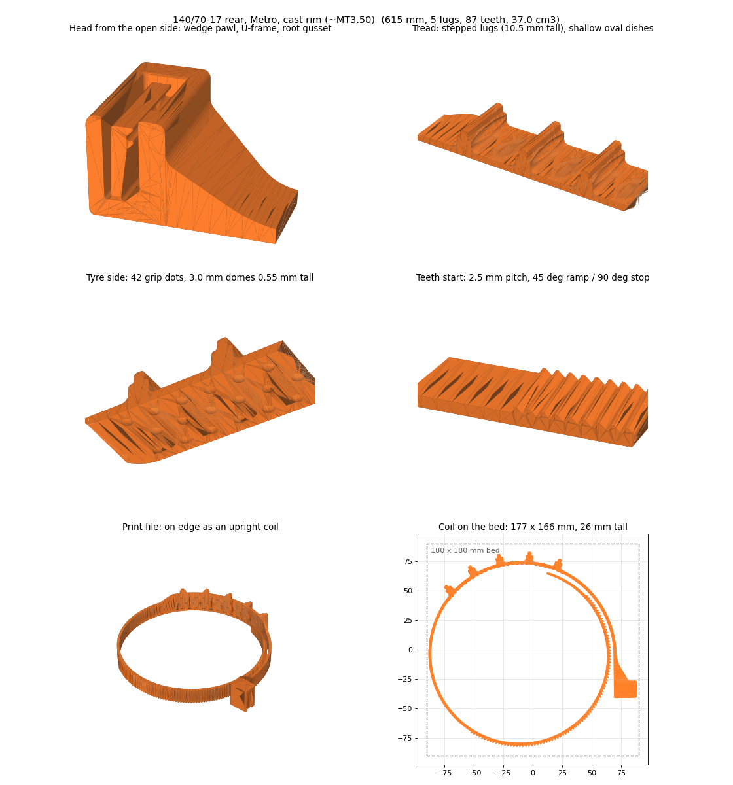
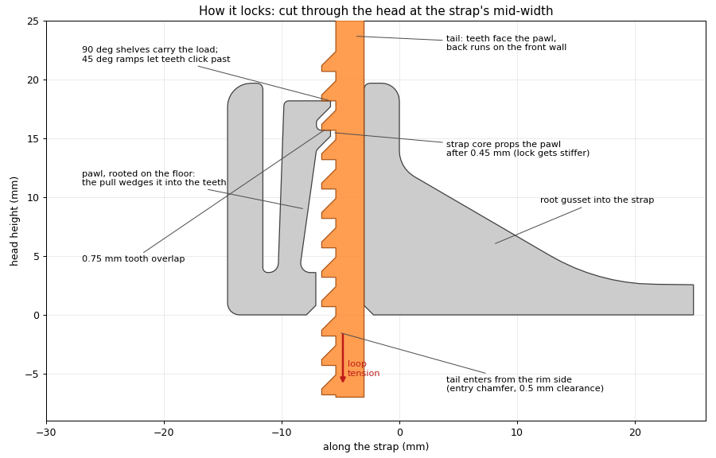
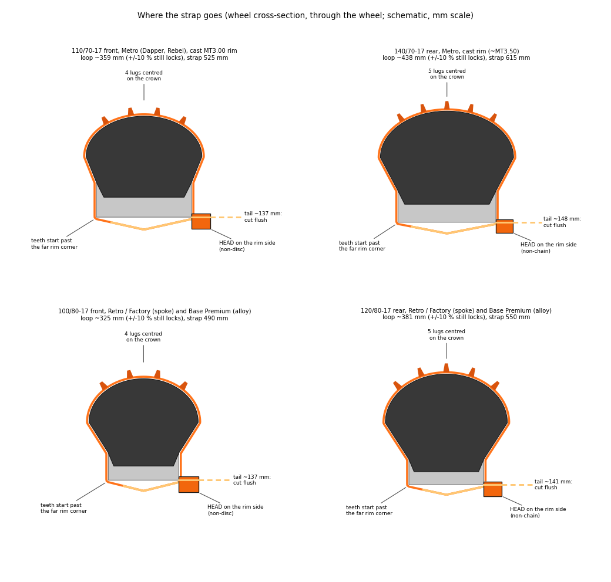
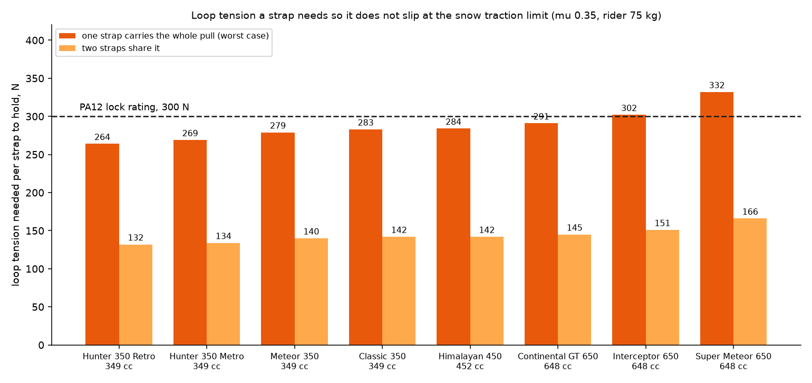

# Snow-traction strap for the Royal Enfield Hunter 350

A 3D-printable, zip-tie style anti-skid strap for motorcycle tyres. It threads through the wheel, wraps tyre and rim, and locks with a wedging two-tooth pawl. The model is fully parametric and built in **FreeCAD 1.1** (OpenCascade). It exports real **STEP** solids as well as print-ready STL files.



## Features

Version 2 combines two earlier designs and sizes the strap for each Hunter 350 tyre:

- from the first strap: the open-top lock with a floor-rooted wedge pawl, and FDM-friendly teeth;
- from the production spec: stepped filleted lugs, oval dishes, tyre-side micro-ribs, 45°/90° teeth, 0.5 mm clearances, an entry chamfer, a rounded tip and gradual ramps.

A finite-element check of the pawl and head set the final tooth shape.

- **Sized per tyre.** The four presets match the Hunter 350's tyres. Each preset sets the strap length, centres the lugs on the tread crown, starts the teeth just past the far rim corner, and leaves a tail to grab. The lock still lands on the teeth if your real loop is 10 % shorter or longer.
- **Wedge-locking pawl.** Pulling on the strap pushes the pawl *into* the teeth. Under load the strap's own core props the pawl, so the lock gets stiffer.
- **Prints on edge as an upright coil.** The teeth, pawl, lugs and strap tension all lie in the layer plane, the strongest direction for FDM. The coil straightens like a tape measure. The coils fit a 180 × 180 mm bed.
- **Shaped by the FEM.**
  - The teeth are at 2.5 mm pitch with 0.4 mm root fillets. At 2.0 mm pitch the 0.25 mm fillets ran about 30 % higher stress.
  - The head has a 3.6 mm floor, a wider frame beside the slot and a gusset into the pillar. With a 2.4 mm floor, the frame would have yielded at about 120 N.
- **Stepped lugs, 10.5 mm above the tyre** (9 mm on the front, for mudguard clearance). Base fillets are 2 mm, with shallow dishes between the lugs and V-groove micro-ribs underneath.
- **Gradual ramps throughout**, a rounded 35 mm tip, and a thick root gusset where the strap leaves the head.



## Presets

| Preset | Hunter 350 | Tyre | Strap | Lugs | Teeth | Mass (PA12) |
|---|---|---|---|---|---|---|
| `METRO_FRONT` | Metro (Dapper, Rebel), cast wheels | 110/70-17 | 525 mm | 4 (low) | 78 | 32 g |
| `METRO_REAR` | Metro (Dapper, Rebel), cast wheels | 140/70-17 | 615 mm | 5 | 87 | 37 g |
| `RETRO_FRONT` | Retro / Factory (spokes), Base Premium | 100/80-17 | 490 mm | 4 (low) | 68 | 31 g |
| `RETRO_REAR` | Retro / Factory (spokes), Base Premium | 120/80-17 | 550 mm | 5 | 73 | 35 g |
| `COUPON` | lock test piece | none | 230 mm | 2 | 34 | 18 g |



## Files

| Path | What it is |
|---|---|
| `out/hunter350_<preset>_PRINT_on_edge_coil.stl` | **Print these.** Already laid out on edge as a coil. The coupon's file is `_PRINT_on_edge.stl`. |
| `out/hunter350_<preset>.step` | STEP solids, straight |
| `out/hunter350_<preset>_straight.stl` | Straight meshes, for checking the geometry |
| `out/hunter350_<preset>_installed_pose.stl` | The strap bent around its tyre and rim section, for viewing |
| `out/hunter350_snow_straps.FCStd` | FreeCAD document with one editable object per preset |
| `out/info.json` | Dimensions, mesh checks, coil size and the fit report for every preset |
| `cad/snow_strap_fc.py` | The generator: FreeCAD GUI macro and headless script |
| `cad/render_previews.py` | Preview images, fitting diagrams and the installed poses (numpy + matplotlib) |
| [`FITTING.md`](FITTING.md) | Printing, fitting and riding guide, with the strength numbers |
| `HANDOFF.md` | Full design history, spec review and verified numbers |
| `legacy/` | The first-generation strap (900 mm, flat spiral) |

## Build it

You need [FreeCAD](https://www.freecad.org/) 1.1 or newer.

**GUI:** set FreeCAD's macro path to this repo's `cad` folder (*Preferences → Python → Macro*), then run *Macro → Macros… → `snow_strap_fc.py` → Execute*. It makes one editable object per preset; change any property and recompute.

The macro path is also how FreeCAD finds the generator when you reopen `out/hunter350_snow_straps.FCStd`, so the document stays parametric.

Don't copy the file into the default macro folder instead. `freecadcmd` imports a script by name, so it would quietly run that copy instead of `cad/snow_strap_fc.py`. The script prints a warning if that happens.

**Headless** (about 2 minutes). This writes everything in `out/` (or in `$STRAP_OUT`). Set `STRAP_PRESETS=METRO_REAR,COUPON` to build only some presets.

```powershell
& "C:\Program Files\FreeCAD 1.1\bin\freecadcmd.exe" cad\snow_strap_fc.py
& "C:\Program Files\FreeCAD 1.1\bin\python.exe" cad\render_previews.py out docs\images
```

## Print and fit

The short version is below. [FITTING.md](FITTING.md) has the step-by-step guide.

**Material.** Use **unfilled PA12 nylon**, dried before printing. For the most consistent straps, order SLS/MJF PA12. The full ranking and the reasons are in [Which filament](#which-filament).
- Avoid carbon- or glass-filled nylon.
- Avoid PLA, PETG, ABS and TPU.

**Printing.** Print the coil exactly as laid out, with 100 % infill, a brim and elephant's-foot compensation. Print the coupon first, and pull-test it warm and cold.

**Fitting.** Use 5–6 straps per wheel.
- The head goes on the rim's side, its slot just past the rim's inner edge. On the rear wheel, use the side away from the chain; on the front, the side away from the brake disc.
- Pull the strap hand-tight, roll the bike, re-tighten, and cut the tail.
- Spin the wheel by hand and check for at least 5 mm of clearance everywhere.

**Riding.** Snow and ice only, 25 km/h at most. The straps are single-use: cut them off when the road clears.

## Strength

A 2D and 3D FEM check (CalculiX, PA12 at E = 1.5 GPa) gives these results. They are estimates, not a load test.

- **Pawl click strain:** 2.7 % at its root fillet as each tooth passes.
- **Pull-through force:** about 50 N warm and about 80 N cold.
- **Pawl body:** stays at or below about 35 MPa at 300 N, because the strap core props it.
- **Weakest points:** the teeth and the head's frame around the slot.
  - With both teeth sharing a 300 N load, the tooth-root fillet sees about 39 MPa peak.
  - With the head seated on the rim, the head's local peaks are 43–49 MPa. The FEM is why the head has a 3.6 mm floor and a gusset.

**Rating:** about 300 N of strap tension in PA12, printed by FDM or SLS. Above that, the teeth start to yield.

Details are in [FITTING.md](FITTING.md#5-strength-and-limits).

### Pressure on each tooth

The lock has two pawl teeth. Pulling on the strap shares the load between them. Each tooth overlaps the pawl by 0.75 mm over a 14.5 mm width, so its bearing face is 10.9 mm². Its root is 1.7 mm long.

| Loop tension | Per tooth | Bearing pressure on the face | Root shear | Fillet peak (FEM, scaled) | Strap core, tension |
|---|---|---|---|---|---|
| 100 N | 50 N | 4.6 MPa | 2.0 MPa | 13 MPa | 2.8 MPa |
| 200 N | 100 N | 9.2 MPa | 4.1 MPa | 26 MPa | 5.6 MPa |
| **300 N (rating)** | **150 N** | **13.8 MPa** | **6.1 MPa** | **39 MPa** | **8.3 MPa** |

- The bearing and shear figures are hand calculations: force divided by area.
- The fillet peak is the FEM result at 300 N (39 MPa), scaled in proportion to the load. That is only valid below yield.
- If the pawl teeth don't share evenly and one tooth takes everything, the bearing pressure doubles (27.5 MPa at 300 N). The FEM then shows an 87 MPa local peak at that tooth's fillet. It yields and passes the load to the other tooth.
- The strap core, at only 8 MPa, is nowhere near its limit. The teeth set the rating.

### Pressure and torque by Royal Enfield model



Only the Hunter 350 has a preset. The other models are shown to give a sense of the load. To use the strap on them, add their tyre to `TYRES` in `cad/snow_strap_fc.py` and rebuild.

**How the load is worked out.** Engine torque does not set the load on snow. The tyre slips first, so the traction limit does:

1. Force at the tyre = μ × rear-wheel load. μ = 0.35 for packed snow with the lugs. The rear wheel carries 55 % of the bike plus a 75 kg rider.
2. The strap's width runs along the tyre, so that force pulls it sideways. It is held by friction between the loop and the tyre and rim: μ 0.4, with the loop wrapping about 4.5 rad.
3. To hold, a strap needs a loop tension of force ÷ (0.4 × 4.5). Compare that with the lock's 300 N rating.

| Model | cc | Engine torque | Kerb weight | Rear tyre | Traction force, snow | Wheel torque at that limit | Loop tension needed, 1 strap carries it all / 2 share | Wheel torque a 300 N lock holds, 1 / 2 straps |
|---|---|---|---|---|---|---|---|---|
| Hunter 350 Retro | 349 | 27 Nm | 177 kg | 120/80-17 | 476 N | 144 Nm | 264 N / 132 N | 163 / 327 Nm |
| **Hunter 350 Metro** | 349 | 27 Nm | 181 kg | 140/70-17 | 483 N | 147 Nm | 269 N / 134 N | 164 / 329 Nm |
| Meteor 350 | 349 | 27 Nm | 191 kg | 140/70-17 | 502 N | 153 Nm | 279 N / 140 N | 164 / 329 Nm |
| Classic 350 | 349 | 27 Nm | 195 kg | 120/80-18 | 510 N | 161 Nm | 283 N / 142 N | 170 / 340 Nm |
| Himalayan 450 | 452 | 40 Nm | 196 kg | 140/80-17 | 512 N | 163 Nm | 284 N / 142 N | 172 / 344 Nm |
| Continental GT 650 | 648 | 52.3 Nm | 202 kg | 130/70-18 | 523 N | 162 Nm | 291 N / 145 N | 167 / 335 Nm |
| Interceptor 650 | 648 | 52 Nm | 213 kg | 130/70-18 | 544 N | 169 Nm | 302 N / 151 N | 167 / 335 Nm |
| Super Meteor 650 | 648 | 52.3 Nm | 241 kg | 150/80-16 | 597 N | 187 Nm | 332 N / 166 N | 169 / 339 Nm |

**What it shows**
- On snow, every model needs about the same wheel torque: 145–190 Nm. A 650 does not load the strap much harder than a 350, because the extra engine torque just spins the wheel.
- With one strap carrying the whole pull, the heavy 650s (Interceptor, Super Meteor) are at or over the 300 N rating. The 350s and the Himalayan use 88–95 % of it.
- With two straps in the contact patch, every model is at or below about 55 % of the rating. That is why you fit 5–6 straps per wheel, not 2–3.
- On ice (μ 0.15) the loads are less than half these, but the straps grip less.
- **Braking** loads the front wheel's straps the same way, up to μ × front load.

**Data and caveats**
- Torque and weights are from published specs: [Hunter, Classic and Meteor 350](https://www.motorbeam.com/?p=301579), [Himalayan 450](https://www.team-bhp.com/new-bikes/royal-enfield/himalayan-450/specifications/), [650s](https://91wheels.com//bikes/royalenfield/continental-gt-650/specifications). Tyre sizes are from [Autocar India](https://www.autocarindia.com/compare-bikes/royal-enfield-super-meteor-650-vs-royal-enfield-interceptor-650), [Motorbeam](https://www.motorbeam.com/?p=304679) and [CEAT](https://www.ceat.com/blog/bike-tyres/the-perfect-fit-understanding-royal-enfield-classic-350-tyre-sizes.html). Sources disagree on some Classic 350 sizes and weights, so read your own tyre sidewall.
- The friction values, the wrap angle and the weight split are assumptions, not measurements. The result moves in proportion to them. Treat the figures as rough, not as safe limits.
- These are static loads at the traction limit. Bumps, wheelspin catching and hard braking add short peaks, which no calculation here covers.
- Rerun the numbers with `python cad/strap_loads.py docs/images`. They are also in `out/loads.json`.

### Which filament

The aim is a strap that grips and holds in the cold of a winter ride, and in the warmth of a summer day on the road or a hot garage, over long rides. **Use unfilled PA12.**

| Rank | Material | Why |
|---|---|---|
| 1 | **PA12 nylon filament**, dried and printed on edge | Stays tough in the cold. Takes up very little moisture, so strength and stiffness stay close to the same from a damp winter to a dry summer. It keeps its shape at road-warm temperatures. The FEM numbers are for this material. |
| 1 | **SLS/MJF PA12** from a print service | The same material with no layer lines or warping. The most consistent result, and the best choice if you want several straps that behave alike. PA11 by SLS is a tougher option still in the cold, but unchecked here. |
| 2 | PA6/66 copolymer nylon | Easy to print and tough, but absorbs much more moisture, so it is softer and weaker when damp. |
| 3 | PA6 nylon | The highest strength when bone-dry, but it swings the most with humidity. In CNC Kitchen's tests of [carbon-filled PA6 and PA12](https://www.cnckitchen.com/blog/carbon-fiber-nylon-in-3d-printing-pa6-vs-pa12-tested), conditioned PA6 kept only 56 % of its dry strength and about a third of its stiffness, against about 15 % lost for PA12. |
| No | Carbon- or glass-filled nylon | Stiffer and stronger in a straight pull, but it stretches very little before it cracks. The pawl bends 2.7 % every time a tooth clicks past, and the teeth have small root fillets, so it is likely to crack. It has not been tested here. |
| No | PLA, PETG, ABS, PC | PLA and PETG crack in the cold, and PLA softens in a hot car or garage. ABS and PC are brittle with notches. |
| No | TPU | Too soft to hold the lock. |

**How to choose a brand.** Pick an unfilled PA12 whose datasheet gives a notched impact figure or an elongation at break of 20 % or more. Dry it for 8–12 h at 70–80 °C and print straight from a dry box. Leave the printed strap in room air for a day or two before fitting.

**What the filament does not do.** It does not set the traction. Grip comes from the lugs biting into snow. Nylon itself is slippery on ice.

**In use.** Nylon creeps (slowly stretches) under steady load, faster when hot. Re-tighten the straps after the first kilometre and every 5–10 km on a long ride, and more often in warm weather.


## Safety

Chains and straps on a two-wheeler change how it handles. Check clearance against the chain, the brake disc and caliper, the ABS sensor, the mudguard, the fork and the swingarm. Ride slowly. These are emergency traction aids. Use them at your own risk.

## Project page

The 3D viewer, the 360° video and the reference photos are in [`docs/`](docs/). The page is `docs/index.html`, served by GitHub Pages.

## License

[CC BY-NC 4.0](LICENSE): free to use, modify and share with attribution, **for non-commercial purposes only**. No commercial use of any kind, including selling the files or prints made from them. The product photos in `docs/images/*.jpg` are not covered by this license.
