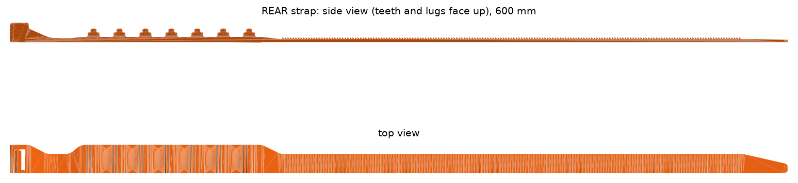
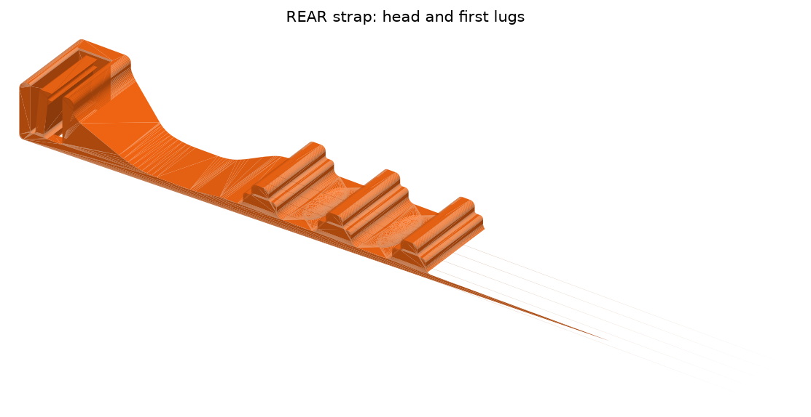
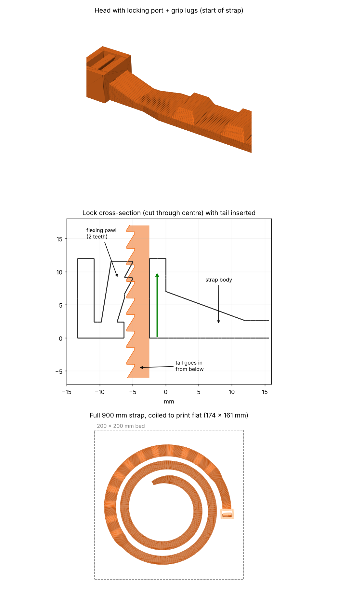

# Snow-traction strap for the Royal Enfield Hunter 350

A 3D-printable, zip-tie style anti-skid strap for motorcycle tyres. It threads through the wheel, wraps tyre and rim, and locks with a wedging two-tooth pawl. The model is fully parametric and built in **FreeCAD 1.1** (OpenCascade), so you can export real **STEP** solids as well as STL.



## Features

- **Wedge-locking pawl.** Pull load pushes the two-tooth pawl *into* the strap. Releasable with a small screwdriver.
- **Stepped, filleted lugs** across the full width, with oval dishes between them and V-groove micro-ribs on the tyre side.
- **Rounded tip and gradual ramps** so it threads through spokes and the head easily.
- **FDM-friendly teeth:** 2.0 mm pitch, 45° insertion ramp, 90° stop face (set it to 1.0–1.2 mm for SLS/MJF).
- **Presets** for the Hunter 350: `REAR` (600 mm, 7 lugs), `FRONT` (520 mm, 5 lugs) and a 230 mm `COUPON` to test the lock.
- **Print on edge as a coil.** The strap is warped into a clock-spring spiral so all loads run in the layer plane (strongest FDM orientation).



## Files

| Path | What it is |
|---|---|
| `cad/snow_strap_fc.py` | The FreeCAD generator (GUI macro and headless script) |
| `out/hunter350_rear.step`, `out/hunter350_front.step` | STEP solids |
| `out/hunter350_*_straight.stl` | Straight meshes, for checking the geometry |
| `legacy/` | The first-generation strap (flat spiral, 900 mm) |
| `HANDOFF.md` | Full design history, spec review and verified numbers |

The print-ready coil STLs are not committed (the rear one is about 350 MB). Regenerate them with the script.

## Build it

Requires [FreeCAD](https://www.freecad.org/) 1.1 or newer.

**GUI:** open `cad/snow_strap_fc.py` in FreeCAD, then *Macro → Execute*. It makes editable `REAR`, `FRONT` and `COUPON` objects. Change any property and recompute.

**Headless** (writes STEP, STL, coil STL and `.FCStd` to `out/`, or to `$STRAP_OUT`). The full run takes several minutes:

```powershell
& "C:\Program Files\FreeCAD 1.1\bin\freecadcmd.exe" -c "import sys; sys.path.insert(0,'cad'); import snow_strap_fc as m; m.main_headless()"
```

## Printing

- **Material:** nylon (PA12 or PA6), dried before printing. PLA and PETG crack in the cold. For the best result, order SLS/MJF PA12 from a print service.
- **Settings:** 100 % infill, 4+ perimeters, print on edge exactly as the coil is laid out.
- **Fit:** print the coupon first. Tune `pawl_*` and clearance parameters if the lock is too tight or loose.
- **Tyre sizes assumed:** Hunter Metro front 110/70-17, rear 140/70-17; Hunter Retro front 100/80-17 (spoke wheel). Measure your own loop and keep at least 100 mm of tail to grab.

## How it locks

The first generation (900 mm car-style strap) showed the idea: the tail enters the head from below and the pawl wedges against the teeth.



## Safety

Chains and straps on a two-wheeler change handling. Check clearance against the chain, brake disc, mudguard, fork and swingarm, and ride slowly. Use at your own risk.

## Project page

The 3D viewer, 360° video and reference photos are in [`docs/`](docs/) (`docs/index.html`, served by GitHub Pages).

## License

[CC BY-NC 4.0](LICENSE): free to use, modify and share with attribution, **for non-commercial purposes only**. No commercial use of any kind, including selling the files or prints made from them. The product photos in `docs/images/*.jpg` are not covered by this license.
